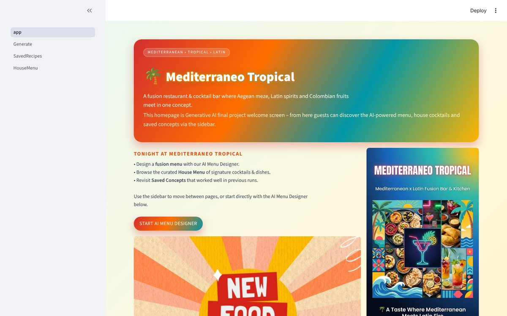
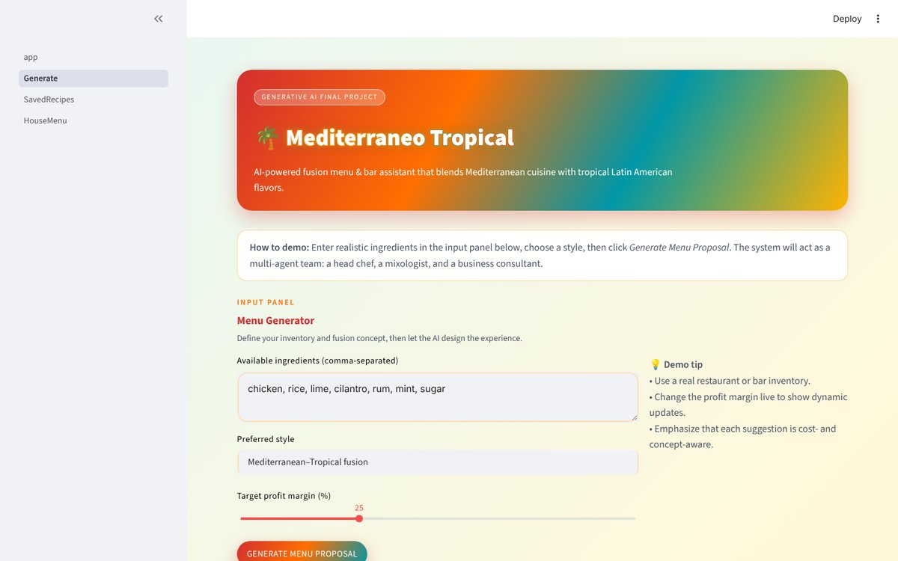
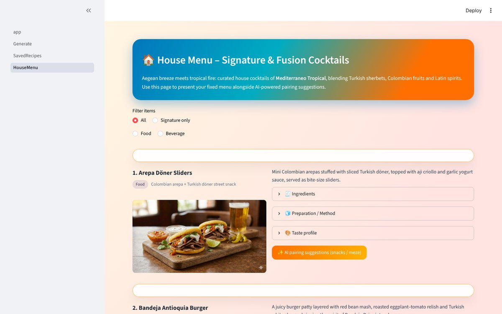

# Mediterraneo Tropical

An AI-powered menu and cocktail designer for a fusion restaurant concept that blends Mediterranean and Turkish cuisine with tropical Latin American flavors. Built with Streamlit and Google Gemini, it uses a team of specialized AI agents to turn a list of available ingredients into a complete menu proposal: a main dish, a paired cocktail, a cost and pricing analysis, and a business recommendation.


## Screenshots



| AI Menu Designer | House Menu |
| --- | --- |
|  |  |

## How It Works

Each request goes through a multi-agent pipeline coordinated by `services/orchestrator.py`:

```
Ingredients + style + target margin
        │
        ▼
 ┌──────────────┐   ┌──────────────────┐   ┌──────────────────┐   ┌──────────────────┐
 │  Chef agent  │ → │ Mixologist agent │ → │  Cost analysis   │ → │  Business report │
 │  main dish   │   │ paired cocktail  │   │ prices & margins │   │  recommendation  │
 └──────────────┘   └──────────────────┘   └──────────────────┘   └──────────────────┘
```

1. **Chef agent** writes a main-course recipe from the available ingredients in the chosen fusion style.
2. **Mixologist agent** designs a cocktail that pairs with the dish.
3. **Cost analysis** estimates ingredient costs and recommends menu prices against the target profit margin.
4. **Report agent** summarizes everything as a short business recommendation.

Each step is a separate prompt with its own role, and the output of earlier agents is passed as context to the later ones.

## Features

- **AI Menu Designer:** Enter ingredients, choose a fusion style and set a target profit margin to generate a full menu proposal.
- **Saved Concepts:** Save generated proposals and browse them later, with recipe, pairing, cost and report sections.
- **House Menu:** A curated menu of 24 signature fusion dishes and cocktails with ingredients, preparation steps and taste profiles, plus on-demand AI pairing suggestions.
- **Model fallback:** If the configured Gemini model is unavailable, the app retries with a fallback model.

## Tech Stack

| Area | Technology |
| --- | --- |
| UI | Streamlit (multi-page app), custom CSS |
| LLM | Google Gemini via `google-generativeai` |
| Configuration | `python-dotenv` |
| Storage | Local JSON files |

## Project Structure

```
mediterraneo-tropical/
├── app.py                  # Landing page
├── config.py               # Environment and brand settings
├── pages/
│   ├── 1_Generate.py       # AI Menu Designer
│   ├── 2_SavedRecipes.py   # Saved menu concepts
│   └── 3_HouseMenu.py      # Curated house menu
├── agents/
│   ├── chef_agent.py       # Main dish recipe
│   ├── mixologist_agent.py # Cocktail pairing
│   └── report_agent.py     # Business recommendation
├── services/
│   ├── orchestrator.py     # Runs the agent pipeline
│   ├── llm_service.py      # Gemini client with model fallback
│   ├── cost_service.py     # Cost and pricing analysis
│   ├── storage_service.py  # Saves and loads menu concepts
│   └── image_service.py    # Placeholder for future image generation
├── data/                   # House menu and saved concepts (JSON)
├── assets/                 # Banner and menu images
└── docs/screenshots/       # README screenshots
```

## Getting Started

**Requirements:** Python 3.9+ and a Google Gemini API key ([get one here](https://aistudio.google.com/app/apikey)).

```bash
git clone https://github.com/tunaxdev/mediterraneo-tropical.git
cd mediterraneo-tropical

python -m venv venv
# Windows: venv\Scripts\activate
# macOS/Linux: source venv/bin/activate

pip install -r requirements.txt
```

Copy `.env.example` to `.env` and add your API key:

```env
GEMINI_API_KEY=your_gemini_api_key_here
LLM_PROVIDER=gemini
LLM_MODEL_NAME=gemini-2.0-flash
```

Then start the app:

```bash
streamlit run app.py
```

The app opens at `http://localhost:8501`.

## About

Developed by **Umut Tuna** as the final project for the Generative AI course at Woosong University.

## License

This project is licensed under the [MIT License](LICENSE).
